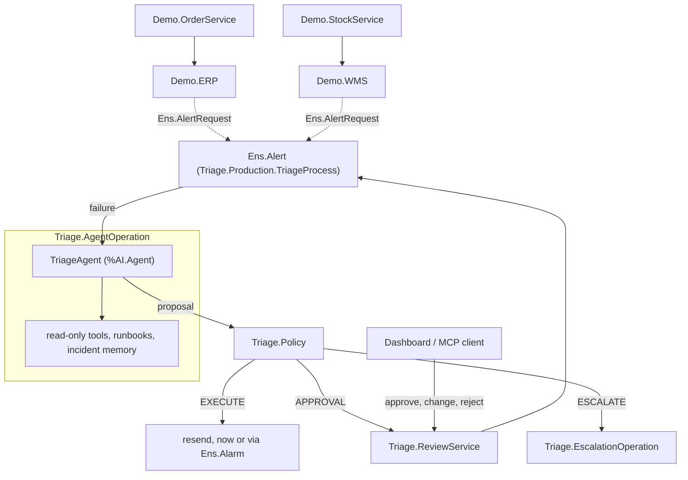

# Interop Triage

**The AI proposes, the code decides, people approve what is risky.**

An IRIS AI Hub agent that triages failed messages inside an InterSystems IRIS interoperability production. Built on the AI Hub Early Access build 154 for the InterSystems contest _AI Agents in Interoperability Workflows_.

When a business operation fails, IRIS sends an alert to `Ens.Alert`. Here `Ens.Alert` is `Triage.Production.TriageProcess`: it asks a `%AI.Agent` to examine the failure with read-only tools, runbooks and past incidents reviewed by people. The agent proposes one action:

| Action           | What happens                                                                    |
| ---------------- | ------------------------------------------------------------------------------- |
| `RETRY`          | delayed resend through `Ens.Alarm`                                              |
| `FIX_AND_RESEND` | resend a copy with a field patch, such as `{"Currency":"EUR"}`                  |
| `DISCARD`        | drop an exact duplicate                                                         |
| `ESCALATE`       | hand the failure to an operator, with the cause and a fix for the source system |

The agent cannot change or resend anything itself. Deterministic, unit-tested rules (`Triage.Policy`) decide whether a proposal runs at once, waits for an operator, or is escalated. Operators review from a dashboard served by IRIS or from their own AI assistant over MCP.

---

## Quick Start

**Prerequisites**

- Docker with Compose v2.
- The AI Hub Early Access image, build 154, community edition: `iris-community-2026.3.0AI.154.0-docker.tar.gz` from the [InterSystems Early Access Portal](https://evaluation.intersystems.com/Eval/early-access/AIHub) (program **AI Hub**).
- Internet access during the build, once: FastEmbed downloads its embedding model.
- Optional: an LLM API key. Without one, the agent runs in [replay mode](#try-it).

**Run**

```bash
docker image load -i iris-community-2026.3.0AI.154.0-docker.tar.gz
git clone https://github.com/FilippoGalli001/Interop-Triage.git
cd Interop-Triage
cp .env.example .env        # optional: put your key in LLM_API_KEY
docker compose up -d --build
```

The build takes about a minute; then `docker ps` shows `iris-triage` as `healthy`. If `docker images` lists the IRIS image under another name, set `IRIS_IMAGE` in `.env`.

**Open** (user `_SYSTEM`, password `SYS`)

| What           | URL                                                                                                                  |
| -------------- | -------------------------------------------------------------------------------------------------------------------- |
| Dashboard      | http://localhost:52773/triage/index.html                                                                             |
| Production     | [EnsPortal.ProductionConfig.zen](http://localhost:52773/csp/triage/EnsPortal.ProductionConfig.zen?$NAMESPACE=TRIAGE) |
| Message Viewer | [EnsPortal.MessageViewer.zen](http://localhost:52773/csp/triage/EnsPortal.MessageViewer.zen?$NAMESPACE=TRIAGE)       |

**Check** the 70 `%UnitTest` assertions and the MCP server:

```bash
docker exec -it iris-triage iris session IRIS -U TRIAGE "##class(Triage.Setup).RunTests()"   # ends with All PASSED
python mcp/smoke_test.py                                                                     # lists the 6 MCP tools
```

`.env` takes `LLM_PROVIDER`, `LLM_MODEL` and `LLM_API_KEY` (tested with OpenRouter + DeepSeek and with Gemini), plus optional token prices for the cost tile. The agent reads them through AI Hub placeholders: `PROVIDERCONFIG = {"model_provider":"@{env:LLM_PROVIDER}"}`.

---

## Try It

Use the buttons at the top of the dashboard:

- **Quick demo**: three failures (a date to approve, a currency fixed automatically, a delayed retry). Fits a free-tier key.
- **Run demo**: all ten failures across two systems, about ten agent runs.
- **Run follow-up**: after Run demo, two new failures similar to earlier ones, to see the memory at work.

With no `LLM_API_KEY` everything runs in **replay mode**, and a yellow banner says so: the tool calls recorded from live runs (`recordings/decisions.json`) run again on the current data, together with the rules, timers and approvals. See [how replay mode stays honest](docs/ARCHITECTURE.md#how-replay-mode-stays-honest).

### The Human in the Loop, in Two Minutes

After **Quick demo**, **SO-1003** waits for approval: the agent turned `21/11/2026` into `2026-11-21`, and reordering a date is a correction, never automatic.

1. Open SO-1003 and change `ShipDate` to `2026-11-22`. The button becomes **Approve with my changes**.
2. Press it with an empty note: refused, because a change must say why. Add a note and approve.
3. The order is resent and delivered with your date; the **Visual Trace** link shows your review as a step of the session.

With **Run demo**, approve SO-1003 the same way and then press **Run follow-up**: SO-1103, from the same customer, cites your review.

---

## Demo Scenarios

Two demo systems, orders to an ERP and stock movements to a warehouse (WMS), send different message classes through `EnsLib.HTTP.OutboundAdapter` to REST endpoints inside IRIS. Every failure is a real HTTP error, and one generic triage process handles both.

| Message             | Failure                                           | Result                                                           |
| ------------------- | ------------------------------------------------- | ---------------------------------------------------------------- |
| SO-1004             | currency `EURO` (422)                             | normalized to `EUR`, resent automatically                        |
| SKU-101             | warehouse `mil01`, codes are case-sensitive (422) | normalized to `MIL01`, resent automatically                      |
| SO-1003             | `ShipDate` `21/11/2026` is not ISO (422)          | correction, waits for approval                                   |
| SO-1001             | same order sent twice (409)                       | discard, waits for approval                                      |
| SO-1005             | tenant API token expired (401)                    | escalated, with credential advice                                |
| SO-1006             | negative amount (409)                             | escalated                                                        |
| SKU-999             | unknown SKU (404)                                 | escalated                                                        |
| SKU-102             | 503 with `Retry-After: 30`                        | retried after 30 s                                               |
| SO-1002, SO-1007    | ERP down for 40 s (502)                           | retried after 60 s; SO-1007 reuses the decision with no LLM call |
| SO-1008             | short 502                                         | recovered by the operation's own retries, no alert               |
| SO-1103 (follow-up) | same date format as SO-1003                       | the proposal cites the operator's earlier review                 |

---

## How It Works



- **Read-only tools, scoped by AI Hub policies.** Eight tools: event log, component settings with secrets redacted, attempt history, similar failures, exact error-code lookup, runbook and incident search, and `submit_decision`, the only way to answer. `%AI.Policy.Authorization` (`ScopePolicy`) denies any call outside the current incident, and payloads and error texts reach the model escaped, as untrusted data.
- **Native retries first.** The operations keep their usual `RetryInterval` and `FailureTimeout`, so short blips never reach the agent. A longer outage leaves the queue after `FailureTimeout`, freeing the messages behind it, and the agent picks the delay from the evidence, such as the target's `Retry-After`.
- **Rules decide.** A proposal runs automatically only if its action is in `AutoActions`, its confidence reaches `MinConfidence`, and any patch is a `normalization` touching only `AutoFixFields`. Anything else waits for a person; unknown actions, invalid patches and protected fields (`OrderId`, `CustomerId`, `Sku`) are escalated. The rules check the fields, not just the model's own label: `gemini-2.5-flash` once called the date reordering a normalization, and it still went to approval.
- **Memory of people's decisions.** Runbooks and reviewed incidents are two `%AI.RAG.KnowledgeBase`s on FastEmbed and the IRIS vector store, inside the container. Only incidents reviewed by a person, with their note, are remembered; automatic decisions never are.
- **Everything is traced.** An AI Hub audit policy logs every tool call, shown on the dashboard with its arguments; each incident links to its Visual Trace, where the agent call, the review and the retry are steps of one session.
- **Alert storms cost one decision.** Failures with the same error signature on the same component within `CoalesceWindow` reuse the open decision with no LLM call, and their retries are staggered (`RetryStagger`).
- **Measured.** On the ten demo failures with `deepseek-v4.1-flash`: 10/10 expected decisions, ~6–9 s and ~4–5k input tokens per decision; in replay mode ~30–400 ms and no tokens.

All thresholds are production settings on `Ens.Alert`, under **Autonomy**, **Retry** and **Cost**. Details: [docs/ARCHITECTURE.md](docs/ARCHITECTURE.md).

---

## From Your AI Assistant (MCP)

`Triage.MCP.Service` (`%AI.MCP.Service`) exposes six tools: summary, list, detail, approve, reject and resolve. Every write needs a note (`Triage.MCP.OperatorPolicy`), approvals pass the same rules as the dashboard, and the reviewer is recorded as `<user> via MCP`.

```bash
claude mcp add iris-triage -- docker exec -i iris-triage python3 /home/irisowner/dev/mcp/stdio_proxy.py
```

In Git Bash on Windows, prefix the command with `MSYS_NO_PATHCONV=1`. Then ask Claude Code _"Which incidents are waiting for my approval?"_. Claude Desktop setup and the reason for the small proxy: [MCP server](docs/ARCHITECTURE.md#mcp-server).

---

## Feedback on AI Hub EAP

Built and verified on build `2026.3.0AI.154.0`.

- **Worked well:** declarative provider and key from `.env`, tools from class method signatures, authorization and audit policies on a toolset, loop detection, and RAG with no external service.
- **Needed workarounds:** no structured-output option on `%AI.Agent`, `AddDocument` does not split long texts, provider-dependent `Usage` keys, denied calls never reaching the audit policy, and an `iris-mcp-server` 2.0.0 issue with current Claude Code versions.

Every observation with its workaround, and what we would like to see: [docs/AIHUB-FEEDBACK.md](docs/AIHUB-FEEDBACK.md).

---

## More

- [docs/ARCHITECTURE.md](docs/ARCHITECTURE.md): agent tools, rules, settings, memory, MCP, dashboard, measurements, tests, and how to plug the triage into your own production.
- Limitations: early access APIs may change; replay mode covers the 11 recorded failures, and new ones are escalated without a key; demo credentials (`_SYSTEM` / `SYS`) are for local use only.
- AI coding assistants (Claude Code, Gemini) and [IRIS Agentic Dev](https://github.com/intersystems-community/iris-agentic-dev) were used during development; design, scenarios and every verification run on build 154 were directed by the author.

**Author:** Filippo Galli ([Developer Community](https://community.intersystems.com/user/filippo-galli), [GitHub](https://github.com/FilippoGalli001))

## License

MIT
