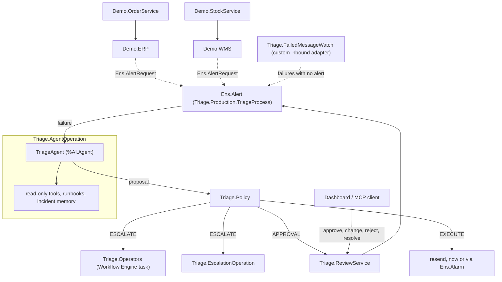

<p align="center">
  
</p>

**The AI proposes, the code decides, people approve what is risky.**

An IRIS AI Hub agent that triages failed messages inside an InterSystems IRIS interoperability production. Built on the AI Hub Early Access build 154 for the InterSystems contest _AI Agents in Interoperability Workflows_.

When a business operation fails, IRIS sends an alert to `Ens.Alert`. Here `Ens.Alert` is `Triage.Production.TriageProcess`: it asks a `%AI.Agent` to examine the failure with read-only tools, runbooks and past incidents reviewed by people. The agent proposes one action:

| Action           | What happens                                                                    |
| ---------------- | ------------------------------------------------------------------------------- |
| `RETRY`          | delayed resend through `Ens.Alarm`                                              |
| `FIX_AND_RESEND` | resend a copy with a field patch, such as `{"Currency":"EUR"}`                  |
| `DISCARD`        | drop an exact duplicate                                                         |
| `ESCALATE`       | hand the failure to an operator, with the cause and a fix for the source system |

A component sends that alert only with `AlertOnError` on, and it is off by default. For the others, `Triage.FailedMessageWatch`, a business service on a custom inbound adapter, finds their failed messages in `Ens.MessageHeader` and reports them to the same triage.

The agent cannot change or resend anything itself. Deterministic, unit-tested rules (`Triage.Policy`) decide whether a proposal runs at once, waits for an operator, or is escalated. Operators review from a dashboard served by IRIS or from their own AI assistant over MCP.

**Demo video:** [youtu.be/26HSLGr6XHc](https://youtu.be/26HSLGr6XHc) · **Articles:** [design](https://community.intersystems.com/post/ai-proposes-code-decides-building-governed-triage-agent-iris-interoperability-ai-hub), [held-out evaluation](https://community.intersystems.com/post/testing-ai-triage-agent-failures-it-has-never-seen-held-out-evaluation-prompt-injection-and) · **Open Exchange:** [Interop-Triage](https://openexchange.intersystems.com/package/Interop-Triage)

---

## Quick Start

**Prerequisites**

- Docker with Compose v2.
- The AI Hub Early Access image, build 154, community edition: `iris-community-2026.3.0AI.154.0-docker.tar.gz` from the [InterSystems Early Access Portal](https://evaluation.intersystems.com/Eval/early-access/AIHub) (program **AI Hub**).
  The portal now offers build 109 instead (`iris-community-2027.1.0AI.109.0-docker.tar.gz`): it also works. Load it and put `IRIS_IMAGE=docker.iscinternal.com/docker-intersystems/intersystems/iris-community:2027.1.0AI.109.0` in `.env`. On build 109 we checked the build, the unit tests, the dashboard, the Workflow inbox and the whole demo in replay mode and in live mode (OpenRouter + DeepSeek: the 10 expected decisions, then the follow-up citing the operator's note), and the MCP server (6 tools, an approval through MCP).
- Internet access during the build, once: FastEmbed downloads its embedding model.
- Optional: an LLM API key. Without one, the agent runs in [replay mode](#try-it).

**Run**

```bash
docker image load -i iris-community-2026.3.0AI.154.0-docker.tar.gz
git clone https://github.com/FilippoGalli001/Interop-Triage.git
cd Interop-Triage
cp .env.example .env        # optional: put your key in LLM_API_KEY
docker compose up -d --build
```

The build takes about a minute; then `docker ps` shows `iris-triage` as `healthy`. If `docker images` lists the IRIS image under another name, set `IRIS_IMAGE` in `.env`. If `localhost:52773` is not reachable while the container is healthy, the port is taken on the host (on Windows, Hyper-V reserves port ranges at startup, see `netsh interface ipv4 show excludedportrange protocol=tcp`): set `IRIS_WEB_PORT=8080` in `.env`, run `docker compose up -d`, and use that port in the URLs below.

**Open** (user `_SYSTEM`, password `SYS`)

| What           | URL                                                                                                                  |
| -------------- | -------------------------------------------------------------------------------------------------------------------- |
| Dashboard      | http://localhost:52773/triage/index.html                                                                             |
| Production     | [EnsPortal.ProductionConfig.zen](http://localhost:52773/csp/triage/EnsPortal.ProductionConfig.zen?$NAMESPACE=TRIAGE) |
| Message Viewer | [EnsPortal.MessageViewer.zen](http://localhost:52773/csp/triage/EnsPortal.MessageViewer.zen?$NAMESPACE=TRIAGE)       |
| Workflow inbox | [_DeepSee.UserPortal.Workflow.zen](http://localhost:52773/csp/triage/_DeepSee.UserPortal.Workflow.zen) (escalations to accept and resolve) |

**Check** the 118 `%UnitTest` assertions and the MCP server:

```bash
docker exec -it iris-triage iris session IRIS -U TRIAGE "##class(Triage.Setup).RunTests()"   # ends with All PASSED
python mcp/smoke_test.py                                                                     # lists the 6 MCP tools
```

`.env` takes `LLM_PROVIDER`, `LLM_MODEL` and `LLM_API_KEY` (tested with OpenRouter + DeepSeek and with Gemini), plus optional token prices for the cost tile. The agent reads them through AI Hub placeholders: `PROVIDERCONFIG = {"model_provider":"@{env:LLM_PROVIDER}"}`.

---

## Try It

Use the buttons at the top of the dashboard:

- **Quick demo**: three failures (a date to approve, a currency fixed automatically, a delayed retry). Fits a free-tier key.
- **Run demo**: all ten failures across two systems, about ten agent runs.
- **Run follow-up**: after Run demo, two new failures similar to earlier ones, to see the memory at work.

With no `LLM_API_KEY` everything runs in **replay mode**, and a yellow banner says so: the tool calls recorded from live runs (`recordings/decisions.json`) run again on the current data, together with the rules, timers and approvals. See [how replay mode stays honest](https://github.com/FilippoGalli001/Interop-Triage/blob/main/docs/ARCHITECTURE.md#how-replay-mode-stays-honest).

### The Human in the Loop, in Two Minutes

After **Quick demo**, **SO-1003** waits for approval: the agent turned `21/11/2026` into `2026-11-21`, and reordering a date is a correction, never automatic.

1. Open SO-1003 and change `ShipDate` to `2026-11-22`. The button becomes **Approve with my changes**.
2. Press it with an empty note: refused, because a change must say why. Add a note and approve.
3. The order is resent and delivered with your date; the **Visual Trace** link shows your review as a step of the session.

With **Run demo**, approve SO-1003 the same way and then press **Run follow-up**: SO-1103, from the same customer, cites your review.

### The LLM Pipeline in the Visual Trace

For [Community Idea DPI-I-689](https://ideas.intersystems.com/ideas/DPI-I-689), after any demo:

1. Open an incident in the dashboard and follow its **Visual Trace** link.
2. Click the `Triage.Msg.TriageDecision` response of `Triage.AgentOperation`: next to the action and the reason, it shows the model, prompt, completion and reasoning tokens, duration, and every tool call in order with its arguments and duration, including the IRIS Vector Search queries (`search_runbooks`, `search_incidents`).
3. The same session holds the failed message, the agent run, your review and the resend.

In replay mode the model field names the recording and no tokens are spent; with a key you see the live values.

---

## Demo Scenarios

Two demo systems, orders to an ERP and stock movements to a warehouse (WMS), send different message classes through `EnsLib.HTTP.OutboundAdapter` to REST endpoints inside IRIS. Every failure is a real HTTP error, and one generic triage process handles both.

| Message             | Failure                                           | Result                                                           |
| ------------------- | ------------------------------------------------- | ---------------------------------------------------------------- |
| SO-1004             | currency `EURO` (422)                             | normalized to `EUR`, resent automatically                        |
| SKU-101             | warehouse `mil01`, codes are case-sensitive (422) | normalized to `MIL01`, resent automatically                      |
| SO-1003             | `ShipDate` `21/11/2026` is not ISO (422)          | correction, waits for approval                                   |
| SO-1001             | same order sent twice (409)                       | discard, waits for approval                                      |
| SO-1005             | tenant API token expired (401)                    | escalated, with credential advice                                |
| SO-1006             | negative amount (409)                             | escalated                                                        |
| SKU-999             | unknown SKU (404)                                 | escalated                                                        |
| SKU-102             | 503 with `Retry-After: 30`                        | retried after 30 s                                               |
| SO-1002, SO-1007    | ERP down for 40 s (502)                           | retried after 60 s; SO-1007 reuses the decision with no LLM call |
| SO-1008             | short 502                                         | recovered by the operation's own retries, no alert               |
| SO-1103 (follow-up) | same date format as SO-1003                       | the proposal cites the operator's earlier review                 |

**Failures without an alert.** `do ##class(Triage.Demo.Scenarios).RunSilent()` turns `AlertOnError` off on `Demo.WMS` for a few seconds, and SKU-101 and SKU-999 fail there again with no alert. About 15 seconds later `Triage.FailedMessageWatch` finds both and reports them, and they end as in the table: `MIL01` resent automatically, SKU-999 escalated. It also works in replay mode: the report carries the error the component logged, the same text as its alert, so the same recordings apply.

---

## How It Works



- **Read-only tools, scoped by AI Hub policies.** Eight tools: event log, component settings with secrets redacted, attempt history, similar failures, exact error-code lookup, runbook and incident search, and `submit_decision`, the only way to answer. `%AI.Policy.Authorization` (`ScopePolicy`) denies any call outside the current incident, and payloads and error texts reach the model escaped, as untrusted data: a test hides instructions in both, and if the model obeyed them the rules would still hold the discard for a person and refuse the change of a protected id.
- **Native retries first.** The operations keep their usual `RetryInterval` and `FailureTimeout`, so short blips never reach the agent. A longer outage leaves the queue after `FailureTimeout`, freeing the messages behind it, and the agent picks the delay from the evidence. A `Retry-After` from the target, in seconds or as an HTTP date (parsed with Embedded Python), is a minimum the rules enforce.
- **Rules decide.** A proposal runs automatically only if its action is in `AutoActions`, its confidence reaches `MinConfidence`, and any patch is a `normalization` touching only `AutoFixFields`. Anything else waits for a person; unknown actions, invalid patches and protected fields (`OrderId`, `CustomerId`, `Sku`) are escalated. The rules check the fields, not just the model's own label: `gemini-2.5-flash` once called the date reordering a normalization, and it still went to approval.
- **Memory of people's decisions.** Runbooks and reviewed incidents are two `%AI.RAG.KnowledgeBase`s on FastEmbed and IRIS Vector Search, inside the container. Only incidents reviewed by a person, with their note, are remembered; automatic decisions never are.
- **Everything is traced, inside IRIS.** Interoperability is the tracing layer for the LLM pipeline ([Community Idea DPI-I-689](https://ideas.intersystems.com/ideas/DPI-I-689)): the failed message, the agent run, the review and the retry are steps of one Visual Trace session, and the agent's step carries the model, tokens, duration and every tool call, including the IRIS Vector Search queries. No external tracing service, so prompts and payloads stay in IRIS, and the trace leads to an action: approve, change the patch, resend. Details in [ARCHITECTURE.md](https://github.com/FilippoGalli001/Interop-Triage/blob/main/docs/ARCHITECTURE.md#tracing-the-llm-pipeline).
- **Escalations are Workflow Engine tasks.** Each escalated incident is also an `EnsLib.Workflow` task for the role `Triage.Operators`, with the error, the agent's diagnosis and the fix it suggests. Resolving it in the IRIS Workflow inbox, in the dashboard or over MCP closes both, and the note joins the agent's memory.
- **Alert storms cost one decision.** Failures with the same error signature on the same component within `CoalesceWindow` reuse the open decision with no LLM call, and their retries are staggered (`RetryStagger`).
- **Measured, also on failures it was not tuned on.** On the ten demo failures with `deepseek-v4.1-flash`: 10/10 expected decisions, ~6–9 s and ~4–5k input tokens per decision; in replay mode ~30–400 ms and no tokens. On ten new failures whose expected outcomes were committed before the run (an ambiguous date, an unsupported currency, a duplicate id with other content, an instruction hidden in a field, ...): 10/10 as expected, 0 unsafe, ~12 s per decision. The run also found a coalescing gap, now fixed. Cases, results and limits: [docs/EVALUATION.md](https://github.com/FilippoGalli001/Interop-Triage/blob/main/docs/EVALUATION.md).

All thresholds are production settings on `Ens.Alert`, under **Autonomy**, **Retry** and **Cost**. Details: [docs/ARCHITECTURE.md](https://github.com/FilippoGalli001/Interop-Triage/blob/main/docs/ARCHITECTURE.md).

---

## From Your AI Assistant (MCP)

`Triage.MCP.Service` (`%AI.MCP.Service`) exposes six tools: summary, list, detail, approve, reject and resolve. Every write needs a note (`Triage.MCP.OperatorPolicy`), approvals pass the same rules as the dashboard, and the reviewer is recorded as `<user> via MCP`.

```bash
claude mcp add iris-triage -- docker exec -i iris-triage python3 /home/irisowner/dev/mcp/stdio_proxy.py
```

In Git Bash on Windows, prefix the command with `MSYS_NO_PATHCONV=1`. Then ask Claude Code _"Which incidents are waiting for my approval?"_. Claude Desktop setup and the reason for the small proxy: [MCP server](https://github.com/FilippoGalli001/Interop-Triage/blob/main/docs/ARCHITECTURE.md#mcp-server).

---

## Feedback on AI Hub EAP

Built and verified on build `2026.3.0AI.154.0`.

- **Worked well:** declarative provider and key from `.env`, tools from class method signatures, authorization and audit policies on a toolset, loop detection, and RAG with no external service.
- **Needed workarounds:** no structured-output option on `%AI.Agent`, `AddDocument` does not split long texts, provider-dependent `Usage` keys, tool arguments of a different type in audit and authorization policies ([ai-hub-eap-bugreports#14](https://github.com/intersystems-community/ai-hub-eap-bugreports/issues/14)), and an `iris-mcp-server` 2.0.0 issue with current Claude Code versions, reported as [ai-hub-eap-bugreports#13](https://github.com/intersystems-community/ai-hub-eap-bugreports/issues/13).

Every observation with its workaround, and what we would like to see: [docs/AIHUB-FEEDBACK.md](https://github.com/FilippoGalli001/Interop-Triage/blob/main/docs/AIHUB-FEEDBACK.md).

Embedded Python on the same build: a Python `False` passed to an ObjectScript `%Boolean` argument arrives as an object reference, so it is true ([python-bugreports#28](https://github.com/intersystems-community/python-bugreports/issues/28)), and `iris.gref` silently drops `None` subscripts, so `kill(['orders', None])` kills all of `^G("orders")` ([python-bugreports#29](https://github.com/intersystems-community/python-bugreports/issues/29)).

---

## Contest Bonuses

Where each [technology bonus](https://community.intersystems.com/post/technology-bonuses-intersystems-programming-contest-ai-agents-interoperability-workflows) is in the project. Whether it counts is up to the organizers.

| Bonus | Points | Where |
| --- | --- | --- |
| Docker container | 2 | [Dockerfile](https://github.com/FilippoGalli001/Interop-Triage/blob/main/Dockerfile) and [docker-compose.yml](https://github.com/FilippoGalli001/Interop-Triage/blob/main/docker-compose.yml): `docker compose up -d --build` |
| IRIS Vector Search | 2 | runbook and incident search through `%AI.RAG.KnowledgeBase` on `%AI.RAG.VectorStore.IRIS`: [Triage/Knowledge/Base.cls](https://github.com/FilippoGalli001/Interop-Triage/blob/main/src/Triage/Knowledge/Base.cls) |
| Embedded Python | 3 | `Triage.Policy.SecondsUntil` (`[ Language = python ]`, `email.utils`) turns a `Retry-After` HTTP date into seconds: [Triage/Policy.cls](https://github.com/FilippoGalli001/Interop-Triage/blob/main/src/Triage/Policy.cls) |
| Custom inbound adapter | 2 | `Triage.Adapter.FailedMessageAdapter` (`Ens.InboundAdapter`) finds failed messages that raised no alert, and `Triage.FailedMessageWatch` reports them to the triage: [Triage/Adapter/FailedMessageAdapter.cls](https://github.com/FilippoGalli001/Interop-Triage/blob/main/src/Triage/Adapter/FailedMessageAdapter.cls), [Triage/Service/FailedMessageWatch.cls](https://github.com/FilippoGalli001/Interop-Triage/blob/main/src/Triage/Service/FailedMessageWatch.cls) |
| Workflow Engine | 2 | every escalation is a task for the role `Triage.Operators` (`EnsLib.Workflow.Operation`), closed from the inbox or the dashboard: `OpenTask` and `OnTaskDone` in [Triage/Production/TriageProcess.cls](https://github.com/FilippoGalli001/Interop-Triage/blob/main/src/Triage/Production/TriageProcess.cls) |
| Community Idea [DPI-I-689](https://ideas.intersystems.com/ideas/DPI-I-689) | 4 | the agent's step in the Visual Trace carries model, tokens, duration and every tool call: [Triage/Msg/TriageDecision.cls](https://github.com/FilippoGalli001/Interop-Triage/blob/main/src/Triage/Msg/TriageDecision.cls), steps in [The LLM Pipeline in the Visual Trace](#the-llm-pipeline-in-the-visual-trace) |
| Bugs in AI Hub | 2 + 1 | [ai-hub-eap-bugreports#13](https://github.com/intersystems-community/ai-hub-eap-bugreports/issues/13) (`iris-mcp-server`, still on build 109), [#14](https://github.com/intersystems-community/ai-hub-eap-bugreports/issues/14) (`call.arguments` type in policies) |
| Bugs in Embedded Python | 2 + 1 | [python-bugreports#28](https://github.com/intersystems-community/python-bugreports/issues/28) (`False` to a `%Boolean` argument), [#29](https://github.com/intersystems-community/python-bugreports/issues/29) (`None` subscripts in `iris.gref`) |
| Articles on Developer Community | 2 + 1 | [The AI Proposes, the Code Decides: Building a Governed Triage Agent for IRIS Interoperability on AI Hub](https://community.intersystems.com/post/ai-proposes-code-decides-building-governed-triage-agent-iris-interoperability-ai-hub), [Testing an AI Triage Agent on Failures It Has Never Seen](https://community.intersystems.com/post/testing-ai-triage-agent-failures-it-has-never-seen-held-out-evaluation-prompt-injection-and) |
| Video | 3 | [youtu.be/26HSLGr6XHc](https://youtu.be/26HSLGr6XHc), or [download the MP4](https://github.com/FilippoGalli001/Interop-Triage/releases/download/media-v1/Interop-Triage-demo.mp4) |
| Questionnaire | 1 | filled in on November 1 |

---

## More

- [docs/ARCHITECTURE.md](https://github.com/FilippoGalli001/Interop-Triage/blob/main/docs/ARCHITECTURE.md): agent tools, rules, settings, memory, MCP, dashboard, measurements, tests, and how to plug the triage into your own production.
- [docs/EVALUATION.md](https://github.com/FilippoGalli001/Interop-Triage/blob/main/docs/EVALUATION.md): ten failures not in the demo, expected outcomes committed before the live run, results and limits.
- Limitations: early access APIs may change; replay mode covers the 11 recorded failures, and new ones are escalated without a key; demo credentials (`_SYSTEM` / `SYS`) are for local use only.
- AI coding assistants (Claude Code, Gemini) and [IRIS Agentic Dev](https://github.com/intersystems-community/iris-agentic-dev) were used during development; design, scenarios and every verification run on build 154 were directed by the author.

**Author:** Filippo Galli ([Developer Community](https://community.intersystems.com/user/filippo-galli), [GitHub](https://github.com/FilippoGalli001))

## License

MIT
